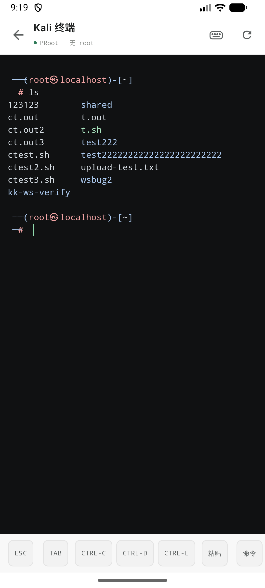
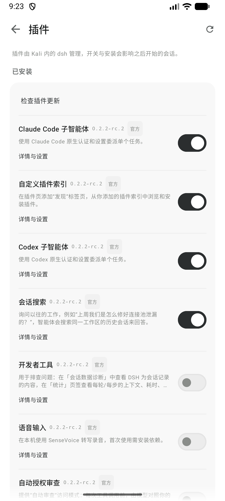
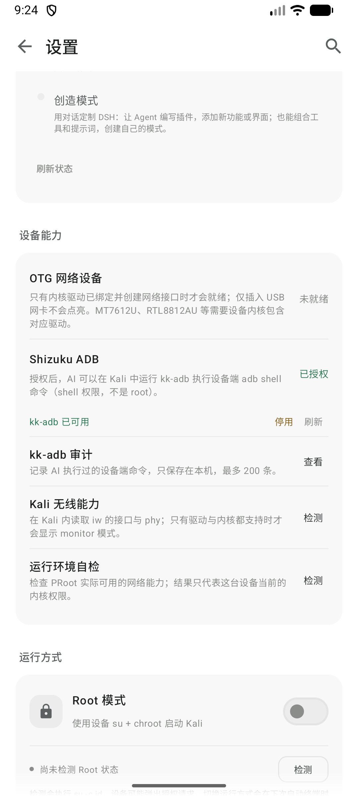
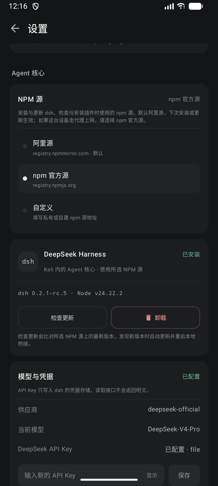

# KingKang for Android

在一台 Android 手机上运行完整的 Kali Linux，并直接和安全研究 Agent 对话。

不需要电脑、不需要刷机、不需要 root。Kali、终端、DeepSeek Harness 和原生对话界面都在同一台设备里；命令、文件与对话记录留在本机，只有发给模型的请求会离开设备。

<table>
  <tr>
    <td align="center"></td>
    <td align="center"></td>
    <td align="center"></td>
  </tr>
  <tr>
    <td align="center"><b>对话</b> 原生界面，工具与审批都在这里</td>
    <td align="center"><b>Kali 终端</b> 随时接手 Agent 的命令</td>
    <td align="center"><b>插件</b> 安装、更新与卸载 dsh 插件</td>
  </tr>
  <tr>
    <td align="center"></td>
    <td align="center"></td>
    <td align="center"></td>
  </tr>
  <tr>
    <td align="center"><b>DeepSeek Harness</b> 完整的 dsh-web 界面</td>
    <td align="center"><b>设置</b> 搜索直达每一项</td>
    <td align="center"><b>模型与凭据</b> API Key 只写不读</td>
  </tr>
</table>

## 功能

### 对话与 Agent

- 流式回复、思考过程、工具调用卡片、审批与提问、子 Agent 下钻。
- 模型与推理等级合并为一个控件；可随时切换权限预设、停止或继续当前回合。
- 会话按 Kali 目录分组，支持搜索、置顶、重命名、分叉、归档与恢复；归档区可折叠。
- 工作台集中查看后台任务、长期目标、定时任务、工作流与交付物。

### Kali 与终端

- 通过 PRoot 在用户空间运行 Kali，不改系统分区，也不需要 root。
- 终端提供 ESC / TAB / CTRL / 方向键与粘贴；命令输入框使用英文键盘，避免输入法把命令转成中文。
- 对话、终端、文件与 Harness 之间可以互相跳转，上下文不丢。

### 文件与工作区

- 浏览整个 Kali 根目录，以 `/` 为顶层，任何目录都能用 `..` 逐级返回。
- 新建文件与文件夹、上传、重命名、删除；预览文本与图片，复制路径，分享或交给其他应用打开。
- 按名称、大小或时间排序；文件页与对话中的交付物直接联动。

### 插件、设备与通知

- npm 插件市场支持分页、检查更新与批量更新；已安装插件可单独开关或卸载。
- 通过 OTG 接入的 USB 网卡会显示状态；Shizuku 授权后，Agent 可用 `kk-adb` 执行设备端 adb shell 命令（shell 权限，不是 root）。
- 设备能力页可查看 kk-adb 审计、运行 Kali 无线能力检测与运行环境自检。
- 后台任务通知可以开关；设置中提供脱敏诊断与可复制的桥接日志。

## 安装

1. 从 [Releases](https://github.com/IHK-ONE/KingKang/releases/latest) 下载 `app-debug.apk`。
2. 在手机上允许「安装未知应用」，然后安装。

要求：Android 8.0 及以上，支持 arm64-v8a 与 x86_64（含常见模拟器）。Kali 与 Agent 合计会占用数 GB 空间，建议至少预留 10 GB。

当前安装包使用 debug 签名，可直接覆盖安装升级。

## 首次使用

**1. 安装 Kali 环境**

打开「设置 → Kali 环境」，点安装。应用会下载官方 Kali NetHunter 镜像，校验后解压。下载时间取决于网络；解压期间请保持应用在前台。

**2. 安装 Agent 核心**

在「设置 → Agent 核心」安装 DeepSeek Harness。默认使用阿里源；如果设备通过代理访问外网，请切换到 npm 官方源。首次安装需要下载依赖，耗时取决于网络与设备。

**3. 配置模型**

在「设置 → Agent 核心 → DeepSeek 官方凭据」填入 API Key 并保存，或在「模型提供方」里配置自己的供应商。等待状态变为「已配置」、Agent 连接就绪即可。

API Key 只写入本机的 dsh 凭据存储，应用不会回读明文。

完成后回到首页新建对话；想直接敲命令，就打开「Kali 终端」。

## 使用提示

- 输入框上方可切换权限、模型与推理等级；点「停止」结束当前回合。
- 输入 `/` 会列出可用命令与技能。
- 长按会话可重命名、分叉、置顶或归档；长按工作区可重命名、排序或移除。
- 切到后台再回来会自动重连；任务完成或失败可以发通知。
- 设置页顶部可搜索并直达具体设置项；「关于」里能检查应用更新。

### 关于 PRoot 的网络限制

PRoot 模式下，普通联网、HTTP、DNS 和端口连接可用；但 Android 不允许普通应用使用原始套接字、抓包和无线 monitor 模式，因此 `nmap` 的常规扫描、`tcpdump` 等工具可能无法工作。

这不是 Kali 缺少工具。可以在「设置 → 设备能力 → 运行环境自检」查看这台设备实际可用的能力。若设备已自行授权 root，可在「运行方式」中切换到 chroot，能力范围会不同。

## 常见问题

**下载或安装很慢、失败怎么办？**

先确认网络可用；在「设置 → Agent 核心」切换 npm 源后重试。安装失败不会破坏已有环境，可以重新安装。

**对话卡住或显示超时？**

点输入框旁的停止按钮结束当前回合，再重新发送。应用切回前台后会自动重连 Agent。

**怎么卸载 Agent 或 Kali？**

在对应卡片的「卸载」中操作。卸载 Agent 会先停止它，再清理程序与依赖缓存。卸载应用会一并删除 Kali、对话和所有本地数据，请提前备份需要保留的文件。

**会获取 root 吗？**

不会。默认始终使用 PRoot；只有设备已自行授权 root 时，才可以在设置里选用 chroot。

**为什么安装包是 debug 签名？**

当前版本面向体验与测试，没有配置正式签名，因此可以直接覆盖安装升级。

## 安全与授权

本项目仅用于**获得授权的安全测试、教学和自有设备上的实验**。请确保你对目标系统拥有测试授权。

运行时不会连接远程 Kali，也不会上传对话或文件；Kali 是 Offensive Security 的商标，本项目与其无隶属关系。

## 开发与许可

- 构建：JDK 17 + Android SDK，运行 `./gradlew assembleDebug`。
- 单元测试：`./gradlew testDebugUnitTest`。
- 本项目以 [Apache License 2.0](LICENSE) 发布；随应用分发或运行的第三方组件（PRoot、Termux 运行库、Kali NetHunter、xterm.js 等）沿用各自许可，详见 [NOTICE.md](NOTICE.md)。
