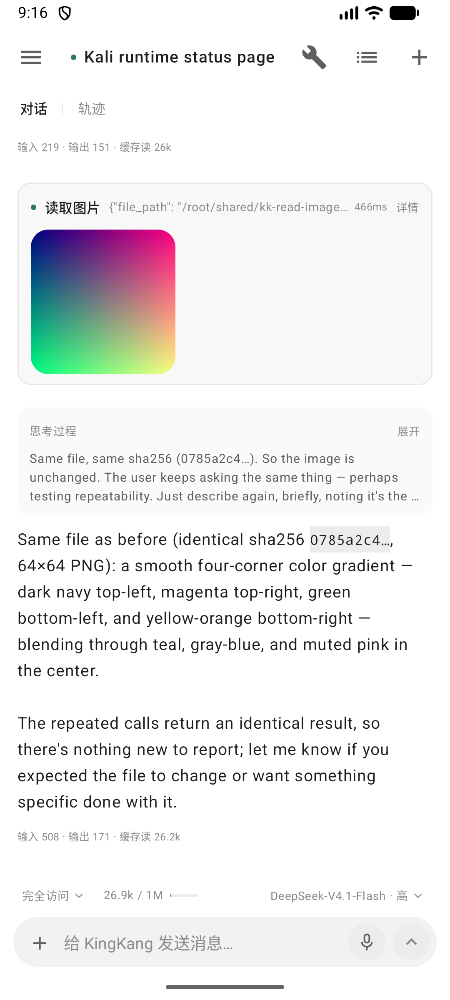
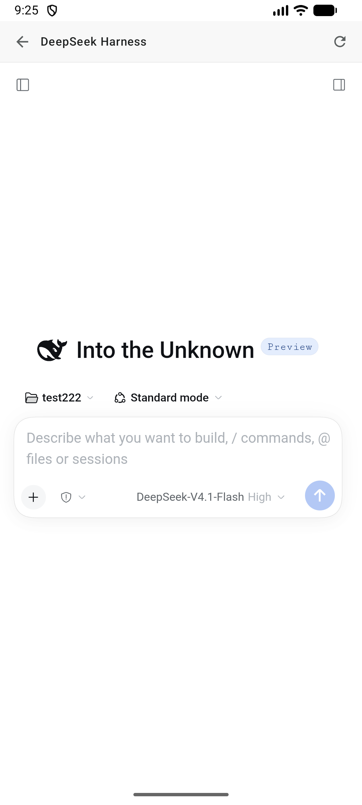

# KingKang for Android

在一台 Android 手机上运行完整的 Kali Linux，并直接和安全研究 Agent 对话。

不需要电脑、不需要刷机、不需要 root。Kali、终端、DeepSeek Harness 与原生对话界面都在同一台设备里；对话、文件和命令结果留在本机，只有发给模型的请求会离开设备。

<table>
  <tr>
    <td align="center"></td>
    <td align="center"></td>
    <td align="center"></td>
  </tr>
  <tr>
    <td align="center"><b>对话</b> 流式回复、工具卡片与审批</td>
    <td align="center"><b>Kali 终端</b> 与 Agent 同一个 Kali</td>
    <td align="center"><b>工作区文件</b> 浏览、上传与编辑</td>
  </tr>
  <tr>
    <td align="center"></td>
    <td align="center"></td>
    <td align="center"></td>
  </tr>
  <tr>
    <td align="center"><b>插件</b> 开关、市场与批量更新</td>
    <td align="center"><b>设备能力</b> 审计、无线检测与自检</td>
    <td align="center"><b>DeepSeek Harness</b> 完整的 dsh-web 界面</td>
  </tr>
</table>

## 目录

- [功能说明](#功能说明)
- [系统要求](#系统要求)
- [安装](#安装)
- [首次使用](#首次使用)
- [使用技巧](#使用技巧)
- [已知限制](#已知限制)
- [常见问题](#常见问题)
- [开发](#开发)
- [安全与授权](#安全与授权)
- [许可](#许可)

## 功能说明

### 对话与 Agent

KingKang 用原生界面承载 DeepSeek Harness 的对话：回复逐字流出，思考过程、工具调用、审批与提问都出现在对话流里，不需要在浏览器和终端之间来回切换。工具卡片可以看到参数、耗时和结果；子 Agent 可以逐层下钻；长回答可以停止、继续，或从某条消息分叉。

输入框上方有一组常用控件：

- **权限**：决定这次对话能读写哪些位置，切换记录在会话里。
- **模型 · 推理等级**：点开先选模型，再用滑块调整推理等级，选择立即生效。
- **上下文用量**：查看上下文占比与明细。

长按会话可以重命名、分叉、置顶或归档；归档区可折叠，展开后点一下即可恢复。工作台集中展示后台任务、长期目标、定时任务、工作流和交付物；长任务完成后可以发通知。

### Kali 与终端

Kali 运行在应用私有目录里的 PRoot 用户空间，不修改系统分区，也不需要 root。Agent 的每条命令都在同一个 Kali 里执行，你随时可以打开「Kali 终端」接手。

终端提供 ESC、TAB、CTRL、方向键和粘贴；需要输入长命令时使用「命令」输入框，它使用英文键盘，避免中文输入法把命令转成拼音。对话、终端、文件页之间可以互相跳转，并带上当前目录。

### 文件与工作区

「工作区文件」以 Kali 的 `/` 为顶层：点目录进入，用 `..` 返回上级。支持新建文件与文件夹、上传、重命名、删除，也可以预览文本和图片、复制路径、分享或交给其他应用打开。

工作区本质上是 Kali 里的一个目录。在左侧「工作区 → 添加」选择目录后，从该工作区新建的对话会以它为当前目录，Agent 读写文件、执行命令都围绕这个目录展开。长按工作区可以重命名、调整顺序或移除；移除只取消分组，不会删除 Kali 里的文件。

### 插件

插件由 Kali 里的 dsh 管理，应用内可以开关、安装、更新和卸载。插件市场从当前 npm 源搜索，支持分页加载；已安装的第三方插件可以检查更新并一次性全部更新，失败项会单独列出。官方插件随 dsh 提供，不参与批量更新。

### 设备能力

通过 OTG 接入的 USB 网卡，只有内核驱动绑定并创建网络接口后才会亮灯；接口存在不代表 Kali 一定能用它抓包。设置里的「Kali 无线能力」会在 Kali 内读取 `iw` 的接口与 phy，并显示是否支持 monitor 模式。

授权 Shizuku 后，Agent 可以用 `kk-adb` 在设备端执行 adb shell 命令（shell 权限，不是 root）。每条命令都会写入本机审计记录，可查看、清空；也可以一键停用这项能力。「运行环境自检」会实测出站 TCP、DNS、原始套接字、抓包、nl80211 等能力，告诉你这台设备实际能做什么。

### 通知、诊断与更新

应用不在前台时，任务完成或失败可以发一条安静的通知；锁屏只显示通用文字。设置里可以关闭通知并查看系统权限。

诊断页提供脱敏的环境摘要和最近的桥接日志，可一键复制或清空；「关于」里可以检查 GitHub 上的新版本。所有输入框、搜索框与弹窗使用同一套样式，设置页顶部可以搜索并直达具体设置项。

## 系统要求

| 项目 | 要求 |
| --- | --- |
| Android | 8.0（API 26）及以上 |
| 架构 | arm64-v8a / x86_64（含常见模拟器） |
| 存储 | Kali 与 Agent 合计数 GB，建议至少预留 10 GB |
| 网络 | 仅模型请求需要外网；Kali 只在应用内回环运行 |

## 安装

1. 从 [Releases](https://github.com/IHK-ONE/KingKang/releases/latest) 下载 `app-debug.apk`。
2. 在手机上允许「安装未知应用」，然后安装。

当前安装包使用 debug 签名，可以直接覆盖安装升级。

## 首次使用

**1. 安装 Kali 环境**

打开「设置 → Kali 环境」，点安装。应用会下载官方 Kali NetHunter 镜像，校验后解压。下载时间取决于网络；解压期间请保持应用在前台。

**2. 安装 Agent 核心**

在「设置 → Agent 核心」安装 DeepSeek Harness。默认使用阿里源；如果设备通过代理访问外网，请切换到 npm 官方源。首次安装需要下载依赖，耗时取决于网络与设备。

**3. 配置模型**

在「设置 → Agent 核心 → DeepSeek 官方凭据」填入 API Key 并保存，或在「模型提供方」里配置自己的供应商。等待状态变为「已配置」、Agent 连接就绪即可。

API Key 只写入本机的 dsh 凭据存储，应用不会回读明文。

完成后回到首页新建对话；想直接敲命令，就打开「Kali 终端」。

## 使用技巧

- 输入 `/` 会列出可用命令与技能；输入框上方可切换权限、模型与推理等级。
- 长按消息可以复制、引用、分支或打分；长按会话可以重命名、分叉、置顶或归档。
- 在「工作区 → 添加」里选择 Kali 目录，之后从该工作区新建的对话会自动使用这个目录。
- 切到后台再回来会自动重连 Agent；任务完成或失败可以收到通知。
- 设置页顶部可搜索并直达具体设置项；「关于」里能检查应用更新。
- 不确定某台设备能做什么时，先运行「设置 → 设备能力 → 运行环境自检」。

### 关于 PRoot 的网络限制

PRoot 模式下，普通联网、HTTP、DNS 和端口连接可用；但 Android 不允许普通应用使用原始套接字、抓包和无线 monitor 模式，因此 `nmap` 的常规扫描、`tcpdump` 等工具可能无法工作。

这不是 Kali 缺少工具。可以在「设置 → 设备能力 → 运行环境自检」查看这台设备实际可用的能力。若设备已自行授权 root，可在「运行方式」中切换到 chroot，能力范围会不同。

## 已知限制

- 默认不获取 root；PRoot 内无法使用原始套接字、抓包和无线 monitor 模式。
- OTG 网卡需要设备内核包含对应驱动；只有驱动绑定并创建网络接口后才会显示就绪。
- 语音与拍照功能需要系统权限，且仅在 Harness 页面内使用。
- 当前安装包为 debug 签名，面向体验与测试。

## 常见问题

**下载或安装很慢、失败怎么办？**

先确认网络可用；在「设置 → Agent 核心」切换 npm 源后重试。安装失败不会破坏已有环境，可以重新安装。

**对话卡住或显示超时？**

点输入框旁的停止按钮结束当前回合，再重新发送。应用切回前台后会自动重连 Agent。

**怎么卸载 Agent 或 Kali？**

在对应卡片的「卸载」中操作。卸载 Agent 会先停止它，再清理程序与依赖缓存。卸载应用会一并删除 Kali、对话和所有本地数据，请提前备份需要保留的文件。

**会获取 root 吗？**

不会。默认始终使用 PRoot；只有设备已自行授权 root 时，才可以在设置里选用 chroot。

**nmap / tcpdump 为什么用不了？**

Android 的普通应用权限不允许原始套接字与抓包，即使 Kali 里已经安装了这些工具。改用 `nc`、`curl`、`bash /dev/tcp` 或 Python 的 socket 做连接测试；具体能力可在「运行环境自检」里查看。

**为什么安装包是 debug 签名？**

当前版本面向体验与测试，没有配置正式签名，因此可以直接覆盖安装升级。

## 开发

- 环境：JDK 17、Android SDK（compileSdk 34）。
- 构建：`./gradlew assembleDebug`
- 单元测试：`./gradlew testDebugUnitTest`
- 发布：`scripts/release.ps1` 会构建、提取 CHANGELOG 说明，并在显式传入 `-Push` / `-Publish` 时推送标签与创建 Release。

欢迎提交 Issue 与 Pull Request。

## 安全与授权

本项目仅用于**获得授权的安全测试、教学和自有设备上的实验**。请确保你对目标系统拥有测试授权。

运行时不会连接远程 Kali，也不会上传对话或文件；Kali 是 Offensive Security 的商标，本项目与其无隶属关系。

## 许可

本项目以 [Apache License 2.0](LICENSE) 发布。随应用分发或运行的第三方组件（PRoot、Termux 运行库、Kali NetHunter、xterm.js 等）沿用各自的许可，详见 [NOTICE.md](NOTICE.md)。
