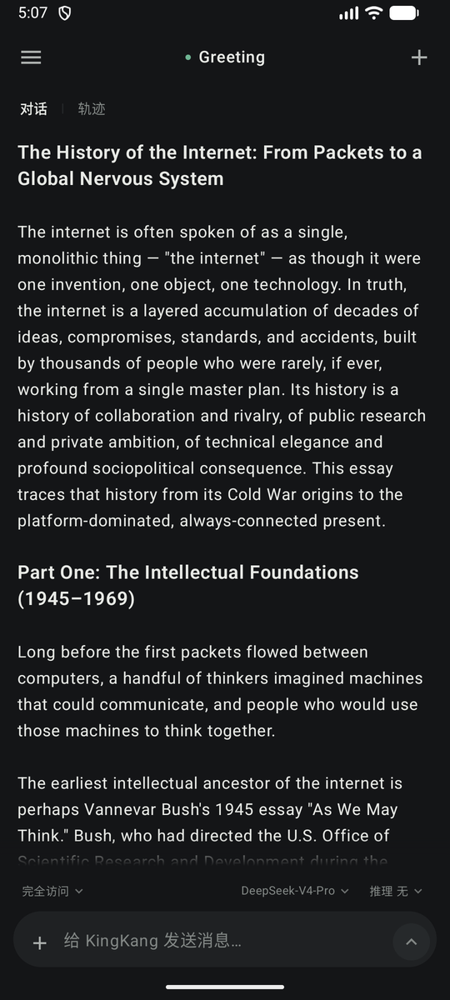
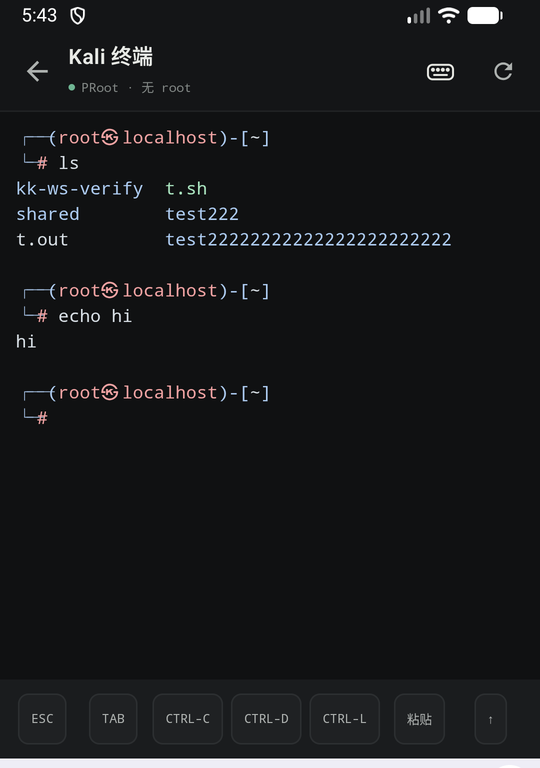
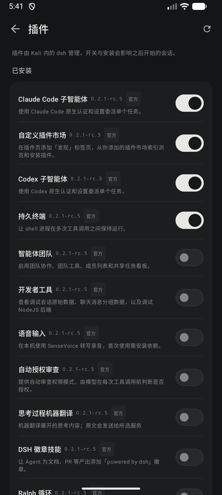
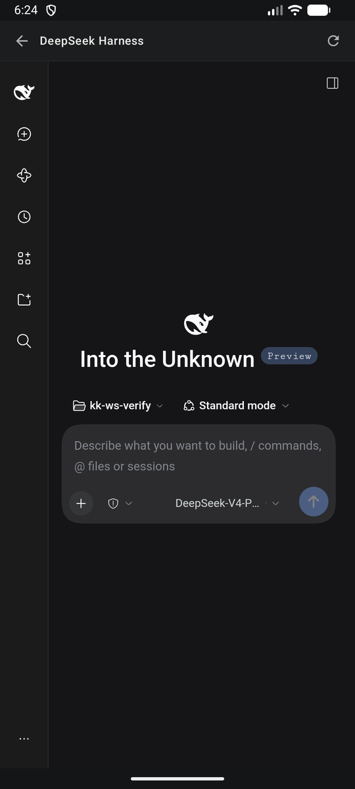
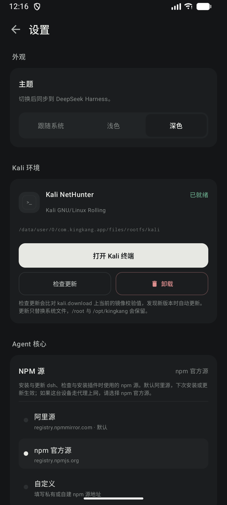
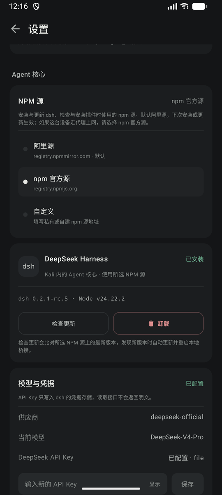

# KingKang for Android

在一台手机上运行完整的 Kali Linux，并直接和安全研究 Agent 对话。

KingKang 把无 root 的 Kali 环境、终端和 DeepSeek Harness Agent 装进同一个 Android 应用。
不用电脑、不用刷机，装上 APK 就能在本地执行命令、处理文件、完成安全测试。

<table>
  <tr>
    <td></td>
    <td></td>
    <td></td>
  </tr>
  <tr>
    <td align="center">对话</td>
    <td align="center">Kali 终端</td>
    <td align="center">插件</td>
  </tr>
  <tr>
    <td></td>
    <td></td>
    <td></td>
  </tr>
  <tr>
    <td align="center">DeepSeek Harness</td>
    <td align="center">设置</td>
    <td align="center">模型与凭据</td>
  </tr>
</table>

## 主要功能

- **本机运行**：Kali 和 Agent 都跑在手机里，不连接远程 Kali；只有与模型的对话会发往你配置的模型服务。
- **无需 root**：通过 PRoot 在用户空间运行 Kali，不修改系统分区。
- **终端与 Agent 联动**：Agent 可以直接在 Kali 里执行命令、读写文件；你也可以随时打开终端接手。
- **原生对话界面**：流式回复、思考过程、工具调用卡片、审批与提问、子 Agent 下钻、
  模型与推理等级切换、停止当前回合。
- **会话管理**：按 Kali 目录建立工作区，支持搜索、置顶、重命名、分叉、归档与恢复。
- **插件**：在应用内开关或安装 dsh 插件，也可以打开完整的 DeepSeek Harness 页面做更细的配置。
- **顺手的小工具**：终端提供 ESC / TAB / CTRL / 方向键与粘贴；输入框可附图片和文件；
  浅色、深色、跟随系统三档主题，切换后 Harness 同步变色。

## 安装

从 [Releases](https://github.com/IHK-ONE/KingKang/releases/latest) 下载 `app-debug.apk`，
在手机上允许「安装未知应用」后安装。

- Android 8.0 及以上
- 支持 arm64-v8a 与 x86_64（含常见模拟器）
- Kali 与 Agent 合计会占用数 GB 空间，首次安装建议至少预留 10 GB

## 第一次使用

**1. 安装 Kali 环境**

打开「设置 → Kali 环境」，点安装。应用会从官方镜像下载 Kali NetHunter，校验后解压。
下载时间取决于网速，解压时需要保持应用在前台。

**2. 安装 Agent 核心**

在「设置 → Agent 核心」安装 DeepSeek Harness。默认使用阿里源；如果这台设备通过代理访问
外网，请切换到 npm 官方源。首次安装通常需要 20–40 分钟。

**3. 配置模型**

在「模型与凭据」里填入 DeepSeek API Key 并保存，等待状态变为「已配置」、Agent 连接就绪。
API Key 只写入本机的 dsh 凭证存储，应用不会回读明文。

完成后回到首页新建对话即可。想直接敲命令，就打开「Kali 终端」。

## 使用提示

- 输入框上方可以切换权限预设、模型与推理等级；点「停止」结束当前回合。
- 输入 `/` 会列出可用命令与技能。
- 长按会话可重命名、分叉、置顶或归档；归档的会话在「已归档」里点一下就能恢复。
- 切到后台再回来会自动重连；通知栏里可以停止 Agent。
- 设置里可以随时检查 Kali 与 Agent 的更新，不需要重新安装。

## 常见问题

**下载或安装很慢、失败怎么办？**
先确认网络可用；在「设置 → Agent 核心」切换 npm 源后重试。安装失败不会破坏已有环境。

**对话卡住或显示超时？**
点输入框旁的停止按钮结束当前回合，再重新发送。应用切回前台后会自动重连 Agent。

**怎么卸载 Agent 或 Kali？**
在对应卡片的「卸载」中操作。卸载 Agent 会先停止它，再清理程序与依赖缓存。
卸载应用会一并删除 Kali、对话和所有本地数据，请提前备份需要保留的文件。

**会获取 root 吗？**
不会。默认始终使用 PRoot；只有设备已自行授权 root 时，才可以通过设置选用 chroot。

**为什么安装包是 debug 签名？**
当前版本面向体验与测试，没有配置正式签名。可以直接覆盖安装升级。

## 说明

本项目仅用于**获得授权的安全测试、教学和自有设备上的实验**。请确保你对目标系统拥有测试授权。
运行时不会连接远程 Kali；Kali 是 Offensive Security 的商标，本项目与其无隶属关系。

## 许可

本项目以 [Apache License 2.0](LICENSE) 发布。随应用分发或运行的第三方组件
（PRoot、Termux 运行库、Kali NetHunter、xterm.js 等）沿用各自的许可，详见 [NOTICE.md](NOTICE.md)。
